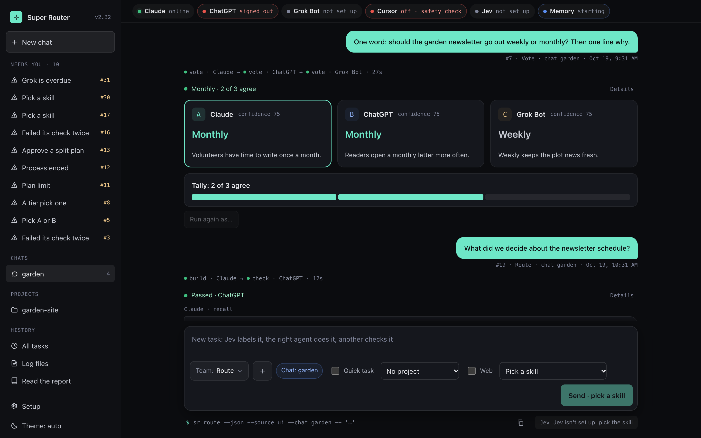

# Super Router

Claude, ChatGPT, Grok and Cursor as one AI team on your Mac. Each task goes to the agent best at it, a second agent checks the work, and a stalled call hands off automatically. Research, red-team, versus and vote modes, task splitting, memory and a local dashboard, all on the AI plans you already pay for.



## What it does

You type a task in Terminal (`sr route "…"`) or on a local web page (`sr serve`). Super Router sends it to Claude, ChatGPT, Grok Bot or Cursor and keeps every task in one log.

- **One skill per task.** Jev, a labeling model, reads each routed task and names its one skill: writing, code, planning, web research, what people are saying on X, reading an image or video you attach, making an image, the same step on many items, a quick answer, and more ([config/skill_table.json](config/skill_table.json) has the full list). When Jev isn't sure, or isn't set up, you pick the skill.
- **One agent does it, another checks it.** The skill table names, for each skill, the agent that does the work and a second agent that checks it. If the check finds a problem, the doer gets one round to fix it, and the fix is checked again. Quick answers aren't checked.
- **Or pick the agent yourself.** Start the text with `@claude`, `@chatgpt`, `@grok` or `@cursor`. That agent does the work whatever the label. Jev still labels the task to pick who checks it, and if the call stops, it isn't handed to anyone else.
- **Teams** (presets) put several agents on one task. Each team has default agents, and you can swap them for a single task. Pick a team on the page, or use `sr relay` in Terminal.
  - `research-build`: One agent researches the web and X, a second builds from what it found, and a third checks the result.
  - `collab`: Two agents work as a pair: one plans, the other improves the plan, the first does the work, and the second edits and checks it.
  - `versus`: Two agents each build their own answer from the task alone and review each other's, then you pick the winner.
  - `redteam`: One agent builds, a second attacks it to find the weak spots, the builder revises (fixing each attack or saying why it doesn't apply), and a checker confirms the fixes.
  - `vote`: Three agents answer the same short question on their own; the majority wins, and a tie comes to you.
- **Split.** `sr split` breaks a big task into up to 4 pieces: Claude plans them, you approve the plan, each piece runs as its own task, and Claude joins the results.
- **Memory per chat or project.** Tag a task with a chat or a project, and the agents get what the router remembers there: earlier results, stored and searched on your Mac. On the page, tasks you send in a chat are tagged with it. A project task also gets the project's handoff notes (`HANDOFF.md`), and the router updates them from the result; make a project with New project on the page or `sr project new` in Terminal.
- **A local page.** `sr serve` starts a page that shows the log and runs the same `sr` commands with buttons. It always shows the exact command it will run.
- **When an agent is missing or stops**, the work moves on by itself:
  - An agent that isn't set up is skipped, and the next in line (usually the skill's second place) does the work. Images and X research are the exceptions: only Grok Bot can do them.
  - A call that fails, hits a plan limit or gets no answer in time goes to the next agent automatically, once per task.
  - The card says who did the work and why. With no other agent free to check, the result is marked unchecked, with the reason.
  - Image making, X research, `@agent` tasks, `versus`, `vote` and Cursor's calls are never handed over.

## Try it in one minute

You need a Mac with Git and Python 3.14 (what it's tested on). The python3 that ships with macOS is too old for the pinned packages; install 3.14 from python.org or Homebrew.

Clone this repo (GitHub's green Code button gives the address) into `~/super-router`, then:

```
cd ~/super-router
python3.14 -m venv .venv
.venv/bin/pip install -r requirements.txt
```

Add the `sr` command to `~/.zshrc`, then open a new Terminal window. (If you cloned somewhere else, use that folder.)

```
sr() { (cd ~/super-router && .venv/bin/python -m router "$@") }
```

Start the page in demo mode, then open the address it prints:

```
sr serve --demo
```

The demo shows invented tasks. Nothing runs, and you need no accounts.

## Set it up

```
cp .env.example .env
```

Then follow [docs/SETUP.md](docs/SETUP.md): one section per piece, each with the Terminal steps to copy. The page's Setup sheet shows the same guide beside each piece's live state. You never run a maintenance command: the router checks the agents and starts memory itself.

- **Claude (required).** Claude Code, signed in with your Claude plan. Claude does or checks most skills, plans and joins splits, and stands in when others are missing. Without it, every task is refused, with the reason.
- **ChatGPT (optional).** OpenAI's Codex CLI, signed in with your ChatGPT plan. Without it, Claude does web research and most results arrive unchecked (nobody else is free to check them). Teams that use ChatGPT won't start until you put another agent in its slot, and `vote` can't run without it.
- **Grok Bot (optional).** A Grok routine the router reaches by webhook; it answers as issues in a private GitHub repo of yours, read with `gh`. Without it: no images and no X research, since nothing else makes the images or sees X posts (for open-web research, pick web research); ChatGPT does the Meta trends research, and the card says "done without Meta"; `research-build` researches the web with ChatGPT; `vote` can't run.
- **Cursor (optional).** Cursor's command line (`agent`), signed in, running one Grok model pinned by name. It adds a coding voice to `versus`. Without it, `versus` runs with Claude and ChatGPT.
- **Jev (optional).** A paid labeling API from TypeSafe, with your key in `.env`. Without it, Terminal asks for each routed task's skill, and the page asks for it before Send.
- **Memory (optional).** Hindsight, a memory store you install once; it runs on your Mac. Without it, tasks still run, but chats and projects don't remember earlier tasks, and a task that asks what the router remembers comes back saying memory is unavailable.

## What it costs

- Claude and ChatGPT run on the plans you already have, through their command lines signed in with your accounts. Grok Bot and Cursor draw on your X Subscription's included pool.
- No per-token API keys. The router refuses to run while any of these is set: `ANTHROPIC_API_KEY`, `ANTHROPIC_AUTH_TOKEN`, `CLAUDE_CODE_USE_BEDROCK`, `CLAUDE_CODE_USE_VERTEX`, `OPENAI_API_KEY`, `CODEX_API_KEY`, `CURSOR_API_KEY`, or an `apiKeyHelper` in Claude's settings.
- For Cursor, keep the prepaid balance at $0 and auto top-up off, and use only a Grok model pinned by name, so nothing can be billed.
- When a plan's limit is reached, another agent takes over or the task stops. Nothing is ever bought to keep going.
- Jev is the one paid API, and it's optional. The router stops calling it after 1,000,000 input tokens a month; check its pricing for your account.
- Memory is local and free: no model call, no key.
- The page and `sr status` make no model calls. Teams and splits make more calls than a single task; a split shows its pieces and agents for your OK before they run.

## Safety

- Keys live only in `.env`, which Git never commits.
- Every result goes through a redactor before it is stored or shown: it masks every `.env` value of 8 characters or more.
- ChatGPT (Codex) and Cursor run sandboxed: they run no commands and write no files, and Cursor gets only text in its prompt (the task; on `versus`, the candidate it reviews), never a file. When either tool updates, its safety check runs by itself before the tool's next task. An agent that fails stays off on that version, and the page says why.
- No agent writes in your projects. The router writes only a project's handoff notes.
- The page listens on 127.0.0.1 only, never reads `.env`, and other websites can't drive it.

## Status

A personal project, shared as is. Tested on macOS only: the router refuses to run on any other system. The demo page skips that check, but it too is tested only on macOS. Everything it does is written down, rule by rule, in [docs/RULES.md](docs/RULES.md).

## License

MIT. See [LICENSE](LICENSE).
