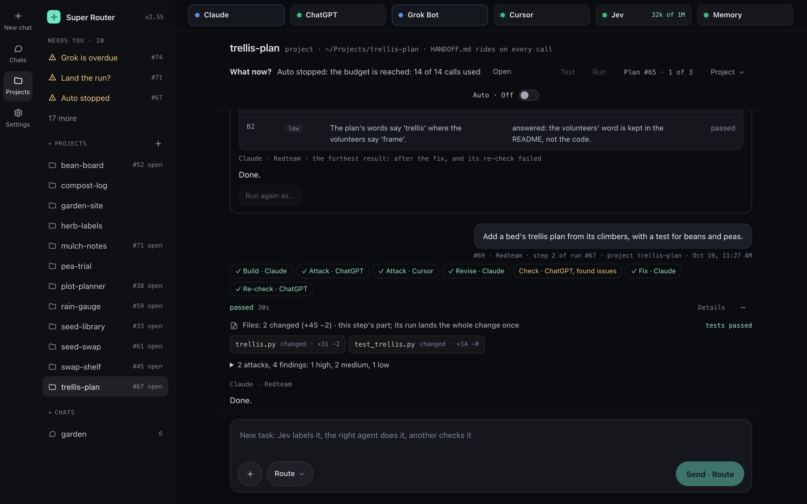

# Super Router

Claude, ChatGPT, Grok and Cursor working as one AI team on your Mac, on the AI plans you already pay for. Each task goes to the agent best at it, a different agent checks the work, and when one stalls the next takes over. Give it a project and it plans the work with you, builds in a copy of your files, runs your tests in a sandbox, and waits for you to land each change as one commit.



## What it does

You type a task on a local web page (`sr serve`) or in Terminal (`sr route "…"`). Super Router sends it to Claude, ChatGPT, Grok Bot or Cursor and keeps every task in one log.

- **One skill per task.** Jev, a labeling model, reads each routed task and names its one skill: writing, code, planning, web research, what people are saying on X, reading an image or video you attach, making an image, the same step on many items, a quick answer, and more ([config/skill_table.json](config/skill_table.json) has the full list). When Jev isn't sure, or isn't set up, you pick the skill.
- **One agent does it, another checks it.** The skill table names the agent that does the work and a second agent that checks it. Only a real problem fails a result. The doer gets one round to fix it, and the fix is checked again. Quick answers aren't checked.
- **Or choose for yourself.** Start the text with `@claude`, `@chatgpt`, `@grok` or `@cursor`, and that agent does the work whatever the label. Jev still labels the task to pick who checks it, and if the call stops, it isn't handed to anyone else. You can also pick the skill, or the model each agent uses, for one task.
- **Memory per chat or project.** Tag a task with a chat or a project, and the agents get what the router remembers there: earlier results, stored and searched on your Mac. On the page, tasks you send in a chat are tagged with it.
- **Standing instructions.** Router notes are your own instructions, sent first on every agent call: some for all agents, some for one.
- **A local page.** `sr serve` starts a page that shows the log and runs the same `sr` commands with buttons. Each agent's light stays in view, each card shows its steps as they run, and everything waiting on you sits in one list.

## Teams

Teams put several agents on one task. Each has default agents, and you can swap them for a single task. Pick a team on the page, or use `sr relay` in Terminal.

| Team | What happens |
|---|---|
| `research-build` | One agent researches the web and X, a second builds from what it found, and a third checks the result. |
| `collab` | Two agents work as a pair: one plans, the other improves the plan, the first does the work, and the second edits and checks it. |
| `versus` | Two agents each build their own answer from the task alone and review each other's, then you pick the winner. |
| `redteam` | One agent builds, two others attack it on their own (neither sees the other's list), the builder revises against both, fixing each attack or saying why it doesn't apply, and a checker confirms. When Cursor, the second attacker, isn't available, the team runs with one attacker and says so. |
| `vote` | Three agents answer the same short question on their own; the majority wins, and a tie comes to you. |
| `split` | Claude breaks a task that is really several things into 2 to 4 pieces, each with its own team and a line on why. You approve or edit the plan, the pieces run one at a time, Claude joins the results and ChatGPT checks the whole. |
| `plan` | On a project: Claude turns a goal into up to 12 steps, ChatGPT and Cursor each attack the plan, Claude revises it, and ChatGPT checks it before you approve. |

## Work on a project

A project is a folder on your Mac. Its notes (`HANDOFF.md`) go with every task, and the router adds a short entry after each one. Make one with New project on the page or `sr project new` in Terminal. With git, Claude changes a copy of its files, the router runs your tests in a sandbox, and you land the checked change as one commit (Undo takes it back).

A project can go from an idea to working code in five moves:

1. **Write a spec.** `SPEC.md` says what the project is for. The agents are held to its `## Examples` and `## Done when` lists, and only you can change it. Draft it asks Claude for a first version.
2. **Plan it.** Plan reads your files and returns steps, each with its team and a finish line a check can confirm. It may ask up to 3 questions first, and it lists what it needs from you: keys, accounts, decisions.
3. **Approve it.** Edit, reorder or drop steps, then Approve. Plan again revises the open steps later and leaves the finished ones alone.
4. **Build it.** Build step 1 runs one step at a time. Or turn on Auto, which runs the steps for you in one copy, within a call budget, and stops where you marked Stop here or when something needs you. Turning it off is the only Stop.
5. **Land it.** Land makes one commit. Auto lands its whole run as one commit, and Undo takes it all back.

Also on a project's bar: **Test** runs your tests now, **Run** starts your program in its real folder when you click it, **Secrets** manages its `.env` without ever showing a value, and **Ideas** keeps what you may want to do later. **What now?** always names the one move that fits.

## When an agent is missing or stops

The work moves on by itself:

- An agent that isn't set up is skipped, and the next in line does the work. Images and X research are the exceptions: only Grok Bot can do them.
- A call that fails, hits a plan limit or gets no answer in time goes to the next agent automatically, once per task.
- The card says who did the work and why. With no other agent free to check, the result is marked unchecked, with the reason.
- Image making, X research, `@agent` tasks, `versus`, `vote` and Cursor's calls are never handed over.

## Try it in one minute

You need a Mac with Git and Python 3.14 (what it's tested on). The python3 that ships with macOS is too old for the pinned packages; install 3.14 from python.org or Homebrew.

Clone this repo (GitHub's green Code button gives the address) into `~/super-router`, then:

```
cd ~/super-router
python3.14 -m venv .venv
.venv/bin/pip install -r requirements.txt
```

Add the `sr` command to `~/.zshrc`, then open a new Terminal window. (If you cloned somewhere else, use that folder.)

```
sr() { (cd ~/super-router && .venv/bin/python -m router "$@") }
```

Start the page in demo mode, then open the address it prints:

```
sr serve --demo
```

The demo shows invented tasks. Nothing runs, and you need no accounts.

## Set it up

```
cp .env.example .env
```

Then follow [docs/SETUP.md](docs/SETUP.md): one section per piece, each with the Terminal steps to copy. The page's Settings tab shows the same guide beside each piece's live state. You never run a maintenance command: the router checks the agents and starts memory itself. Once it's running, [docs/GUIDE.md](docs/GUIDE.md) shows how to use all of it.

- **Claude (required).** Claude Code, signed in with your Claude plan. Claude does or checks most skills, plans and joins splits, builds in your projects, and stands in when others are missing. Without it, every task is refused, with the reason.
- **ChatGPT (optional).** OpenAI's Codex CLI, signed in with your ChatGPT plan. Without it, Claude does web research and most results arrive unchecked (nobody else is free to check them). Teams that use ChatGPT, and Plan, won't start until you put another agent in its slot, and `vote` can't run without it.
- **Grok Bot (optional).** A Grok routine the router reaches by webhook; it answers as issues in a private GitHub repo of yours, read with `gh`. Without it: no images and no X research, since nothing else makes the images or sees X posts (for open-web research, pick web research); ChatGPT does the Meta trends research, and the card says "done without Meta"; `research-build` researches the web with ChatGPT; `vote` can't run.
- **Cursor (optional).** Cursor's command line (`agent`), signed in, running one Grok model pinned by name. It's the second attacker on `redteam` and Plan, and a coding voice in `versus`. Without it, those run with one attacker, or with Claude and ChatGPT.
- **Jev (optional).** A paid labeling API from TypeSafe, with your key in `.env`. Without it, Terminal asks for each routed task's skill, and the page asks for it before Send.
- **Memory (optional).** Hindsight, a memory store you install once; it runs on your Mac. Without it, tasks still run, but chats and projects don't remember earlier tasks, and a task that asks what the router remembers comes back saying memory is unavailable. It can be switched off in Settings → Memory.
- **Git (optional).** What lets the router change a project's files safely. Without it, a project's tasks get its notes and no file changes.

## What it costs

- Claude and ChatGPT run on the plans you already have, through their command lines signed in with your accounts. Grok Bot and Cursor draw on your X Subscription's included pool.
- No per-token API keys. The router refuses to run while any of these is set: `ANTHROPIC_API_KEY`, `ANTHROPIC_AUTH_TOKEN`, `CLAUDE_CODE_USE_BEDROCK`, `CLAUDE_CODE_USE_VERTEX`, `OPENAI_API_KEY`, `CODEX_API_KEY`, `CURSOR_API_KEY`, or an `apiKeyHelper` in Claude's settings.
- For Cursor, keep the prepaid balance at $0 and auto top-up off, and use only a Grok model pinned by name, so nothing can be billed.
- Claude runs Sonnet 5.5 unless you choose otherwise. Fable 5.1 stays off until you turn it on, since it can charge usage credits: turn it on only with those credits off. A call that's billed to them stops its task and turns Fable off.
- When a plan's limit is reached, another agent takes over or the task stops. Nothing is ever bought to keep going.
- Jev is the one paid API, and it's optional. The router stops calling it after 1,000,000 input tokens a month; check its pricing for your account.
- Memory is local and free: no model call, no key.
- The page and `sr status` make no model calls. Teams, splits, plans and Auto make more calls than a single task. A split and a plan show their pieces or steps and an estimate for your OK before they run, and Auto stops at its budget.

## Safety

- Keys live only in `.env`, which Git never commits.
- Every result goes through a redactor before it is stored or shown: it masks every `.env` value of 8 characters or more.
- ChatGPT (Codex) and Cursor run sandboxed: they run no commands and write no files, and Cursor gets only text in its prompt, never a file. When either tool updates, its safety check runs by itself before the tool's next task. An agent that fails stays off on that version, and the page says why.
- No agent writes in your projects: Claude changes a copy, with no tool that runs a command. A project's tests run in a macOS sandbox with no network and no keys.
- The router writes in a project only what you land (one commit, which Undo takes back), what you save or add yourself (notes, spec, files, git when you turn on undo), a plan's `docs/PLAN.md` and the handoff notes; it never rewrites git history.
- **Run is the exception, on purpose:** it starts your own program in its real folder, with no sandbox and no time limit. Only your click or command starts it.
- The page listens on 127.0.0.1 only, never reads `.env`, and other websites can't drive it.

## Status

A personal project, shared as is. Tested on macOS only: the router refuses to run on any other system. The demo page skips that check, but it too is tested only on macOS. Everything it does is written down, rule by rule, in [docs/RULES.md](docs/RULES.md).

## License

MIT. See [LICENSE](LICENSE).
